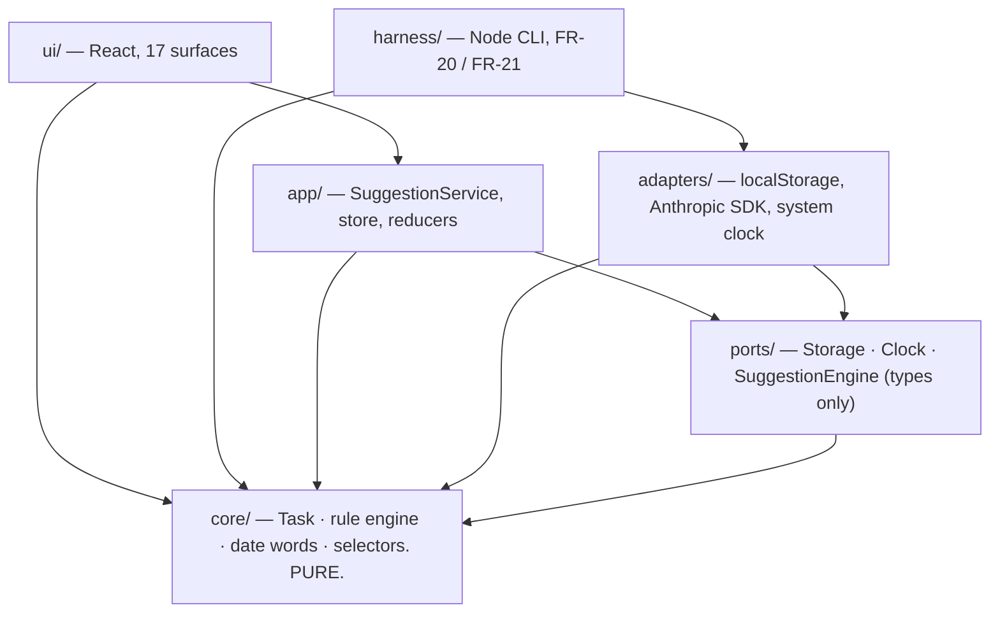
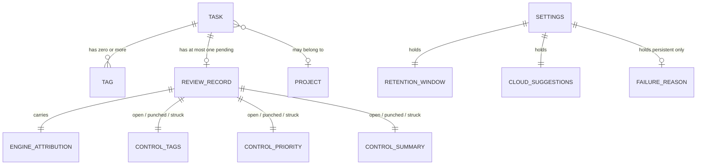
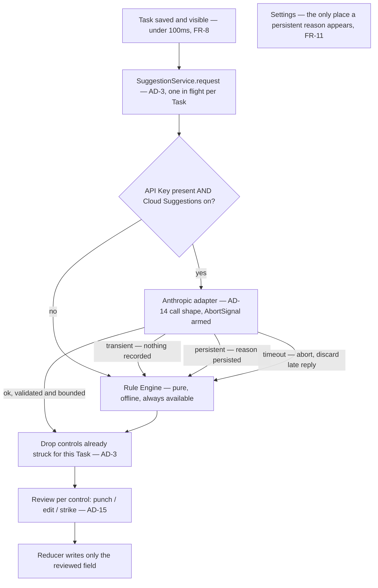
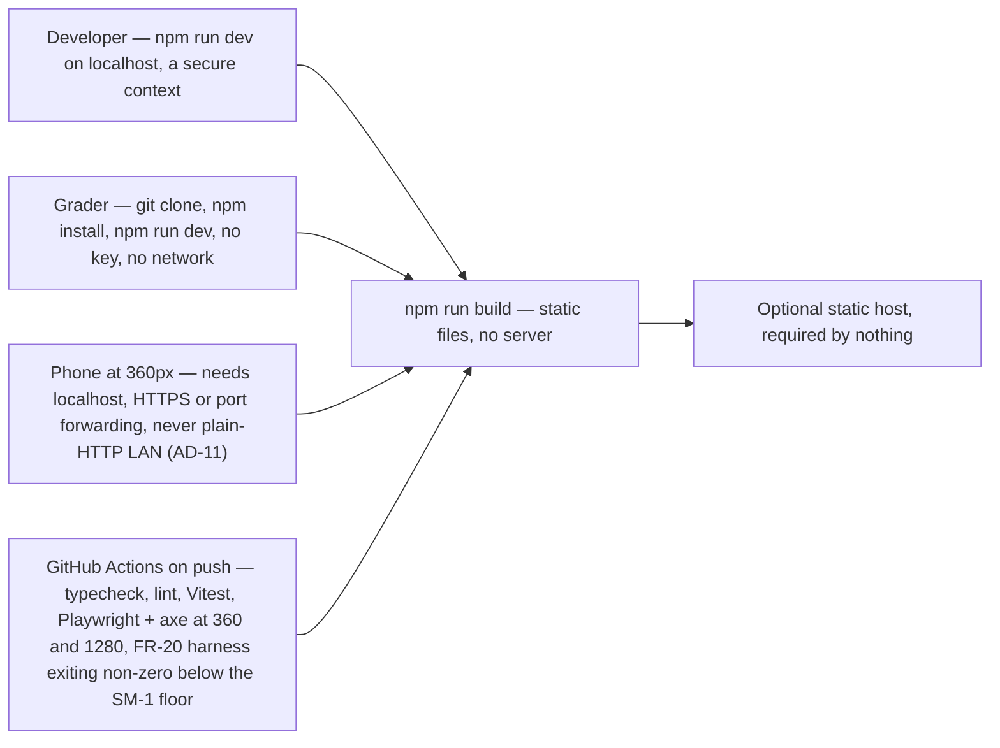

# Architecture Spine — To-Do-List

## Design Paradigm

**Ports and adapters, dependency direction strictly inward.** The driver is not taste: FR-20 and
FR-21 run the Rule Engine, the date parser and the Smart List selectors as a **Node command**, while
the same logic serves the browser. Code that must execute in two runtimes cannot depend on either.

| Layer | Directory | May depend on |
| --- | --- | --- |
| Domain | `src/core/` | nothing |
| Ports | `src/ports/` | `core` (types only) |
| Adapters | `src/adapters/` | `ports`, `core` |
| Application | `src/app/` | `ports`, `core` |
| Interface | `src/ui/` | `app`, `ports`, `core` |
| Harness | `harness/` | `core`, `adapters`, `ports` |



No arrow leaves `core`. Composition happens once, at `src/main.tsx` for the app and
`harness/run.ts` for the command; nothing else constructs an adapter.

**Layered, not vertical slices.** `technology.md` mirrors vertical slices across front and back; that
shape does not transfer, because here one pure core is shared by two runtimes and slicing would
duplicate it per slice. Layering is the honest shape for this constraint.

## Invariants & Rules

### AD-1 — `core/` is runtime-agnostic, deterministic, and reads no ambient time

- **Binds:** all of `src/core/`; consumed by FR-7, FR-12–FR-16, FR-20, FR-21, FR-23, NFR-5
- **Prevents:** a browser global crashing the Node command, and a non-deterministic or zone-dependent
  value entering a function NFR-5 requires to answer identically every time. (Preventing a *duplicate*
  of the Rule Engine is AD-12's job, not this Rule's — a copy can obey every ban here.)
- **Rule:** no module under `src/core/` may reference `window`, `document`, `localStorage`, `fetch`,
  `process`, `navigator`, `performance`, `crypto`, `Math.random`, React, or any Vite-injected value.
  It may not read **ambient time**: no `Date.now()`, no zero-argument `new Date()`, no `Intl` call
  that defaults to the system zone. Calendar arithmetic on an *explicitly supplied* value is permitted
  and confined to one module, `src/core/localdate.ts`. `core/` exports pure functions and types only,
  and generates no identifiers. Enforced by ESLint `no-restricted-globals` plus `no-restricted-imports`
  scoped to the directory — the mechanism AD-2 names, applied to the whole ban list.

The ban is on *reading the clock*, not on the `Date` constructor — FR-23's parsing and FR-16's day
arithmetic are core concerns and must be buildable there. No date library is required.

### AD-2 — Time enters only through the Clock port, and the domain has no instants

- **Binds:** FR-12, FR-15, FR-16, FR-23, FR-20, FR-21, NFR-10
- **Prevents:** date-dependent behaviour that passes on a Tuesday and fails on a Sunday; a day
  boundary that resolves differently in the app and the harness; and the time-zone ambiguity that
  sits between a stored instant and NFR-10's promise of identical results on any machine
- **Rule:** the Clock port exposes exactly one operation, `today(): LocalDate`. A `LocalDate` is the
  string `YYYY-MM-DD` in the device's local calendar — **there are no instants anywhere in the
  domain.** `dueDate` and `completedAt` are both `LocalDate`. `Date` and `Date.now` are reachable
  only inside `src/adapters/system-clock.ts`; the harness supplies the Fixture's fixed reference date
  through the same port, so app and harness agree by construction. Enforced by an ESLint
  `no-restricted-globals` rule, not by discipline.

Consequence accepted: completion carries no time of day. Nothing in DESIGN.md or EXPERIENCE.md
displays one, and day granularity is what FR-16's 30-day window actually needs.

### AD-3 — `SuggestionService` is the only route from the app to an engine

- **Binds:** FR-6, FR-8, FR-9, FR-11, FR-18, FR-22, NFR-2, NFR-6
- **Prevents:** capture and "Suggest again" each implementing FR-9's policy and drifting on the
  transient-versus-persistent split — a drift tests may not catch, because both paths still produce
  a Suggestion — and an unthrottled paid call loop behind FR-22
- **Rule:** `src/app/suggestion-service.ts` owns the consent gate, engine selection, the NFR-2
  timeout, failure classification, fallback and FR-11 attribution. No module under `src/ui/` may
  import an engine implementation. **At most one request may be in flight per Task**, and the
  "Suggest again" control is disabled while one is. Before a fresh Suggestion becomes reviewable the
  service **filters it against that Task's struck set** (AD-7), so a struck control is never
  re-proposed for that Task. Only `harness/` addresses engines by name, deliberately bypassing the
  service so FR-20 and FR-21 can measure each one.

FR-9's precondition is **one pure predicate** in `core/`, `mayUseModelEngine(hasKey,
cloudSuggestions)`, and that predicate is its only expression in the codebase. The service evaluates it
**per request** against the store's current state, so FR-18's "turning it off stops all outbound
requests immediately" cannot degrade into "after a reload". `cloudSuggestions` is written by exactly
one action, dispatched only by the FR-18 toggle: **saving or clearing the API Key never writes
`todo.settings.v1`**, which is what makes FR-18's "saving a key never enables it" and "clearing and
re-saving does not re-enable it" true for the same structural reason.

### AD-4 — Engines never throw, and the adapter owns validation and bounds

- **Binds:** FR-6, FR-9, FR-11, NFR-6
- **Prevents:** FR-9's two failure classes being reconstructed by whoever catches — inconsistently;
  FR-11's three separately-worded statuses degrading into string matching on an error message; and a
  schema-valid but unbounded field reaching a locked layout that cannot hold it
- **Rule:** every `SuggestionEngine` implementation returns an `EngineResult` and throws nothing.
  Failure is `transient`, or `persistent` with one of exactly three named reasons. **Any
  `stop_reason` other than `end_turn` is a failure** — a rule rather than a list, so a provider
  adding a value cannot silently pass; `refusal` and `max_tokens` are named only because the
  addendum calls them out. The adapter validates the response against the zod schema in
  `core/suggestion.ts` and **bounds it before returning**: Summary truncated to one named maximum,
  Tag count and Tag length bounded, Tags lowercased, **any Tag outside FR-7's four dropped**, and
  Priority compared case-insensitively. A response failing validation is a `transient` failure,
  never an exception.

```ts
type EngineResult =
  | { ok: true;  suggestion: Suggestion; engine: 'rule' | 'model' }
  | { ok: false; kind: 'transient' }
  | { ok: false; kind: 'persistent';
      reason: 'invalid_key' | 'quota_exhausted' | 'org_forbids_browser' }
```

### AD-5 — The timeout cancels, and a late response is discarded

- **Binds:** FR-8, FR-9, NFR-2, NFR-6
- **Prevents:** a control changing state on its own, which EXPERIENCE.md's State Patterns forbid — a
  Model Engine answer arriving after the Rule Engine has already served would rewrite a proposal the
  user may already be reading
- **Rule:** the Model Engine request is issued with an `AbortSignal`; the NFR-2 timeout aborts it and
  resolves the call with the Rule Engine's Suggestion. A response arriving after the abort is dropped
  unwritten, unattributed and unlogged. NFR-2's value is pending OQ-1 and is read from one named
  constant, never inlined.

### AD-6 — Persistence: three keys, one synchronous port, one writer  `[ADOPTED]`

- **Binds:** all persistence; FR-1–FR-5, FR-16, FR-17, FR-18
- **Prevents:** two modules choosing different persistence APIs; clearing the API Key rewriting the
  task document; an API Key riding along in a future export; an async Suggestion arrival clobbering
  an interleaved text edit; and — the dangerous one — silent data loss behind a product rule that
  forbids error states
- **Rule:** `localStorage`, reached only through `src/adapters/local-storage.ts`, behind a
  **synchronous** port. Three keys, never one: `todo.tasks.v1` (the task document, and the only key a
  future export may touch), `todo.settings.v1` (retention window, Cloud Suggestions state, the
  persisted engine-failure reason) and `todo.apikey.v1` (the key alone). **Both the task and the settings
  document carry a `schemaVersion`**, read and written only by the adapter. Adding an optional field
  whose absence is indistinguishable from its default does **not** bump the version; adding a required
  field, renaming one, or changing an existing one bumps it by one and adds one `migrateNtoN+1` to a
  single ordered chain applied on read. Absent, unreadable or unmigratable documents resolve through
  **one named defaults factory**, never a call-site fallback, and the fail-safe direction is fixed:
  **Cloud Suggestions `false`**, retention 30 days — §8 makes consent the one privacy-bearing flag in
  the system, so it fails closed.
  **The reducer is the single writer:** no module writes storage directly, and an async engine result
  arrives as a dispatched action that merges into current state rather than overwriting a snapshot
  taken before the await. Storage operations return a `StorageResult` and never throw — a
  quota-exceeded or unavailable `localStorage` leaves the app fully usable in memory for the session
  and reports in **Settings only**, never in capture or review. A document failing validation on read
  is **never discarded**: the raw string is preserved under a backup key, the app starts empty, and
  Settings says so.

Resolves PRD OQ-8. Chosen because FR-12–FR-15 recompute from every non-archived Task on every render
and store no membership, so all Tasks are in memory whichever API is used and IndexedDB's indexed
queries would be bought and never issued. Accepted cost: the whole document is re-serialized per
mutation, on the main thread — bounded by the FR-8 performance test the Tests convention requires,
run against a Fixture-sized document, so the trade is audited rather than merely accepted. Cross-tab
writes are last-writer-wins; nothing attempts a merge.

### AD-7 — Derived values are computed; user acts are recorded

- **Binds:** FR-2, FR-5, FR-8, FR-10, FR-11, FR-12–FR-16, FR-22
- **Prevents:** a stored flag becoming a second source of truth that disagrees with the data it was
  derived from; a time-triggered sweep writing to storage; and the opposite error — deriving review
  state by comparing values, which is wrong for an edit to the same value and for accepting
  `medium`, the default
- **Rule:** **computed, never stored:** completion, archive status, Smart List membership, Band
  counts. The Task persists `completedAt` as a `LocalDate` or null — never a `completed` boolean,
  never an `archived` flag. **Recorded, never derived:** every per-control review act. A Suggestion
  that has *arrived* is persisted with its Task as an explicit record carrying the three proposed
  values, **the engine that produced them** (FR-11), and a state of `open`, `punched` or `struck` for
  each of Tags, Priority and Summary. The struck entries are the struck set AD-3 filters against. A
  request still *in flight* is not persisted, so a reload leaves the Task at its defaults exactly as
  FR-8 describes. The single-step undo buffer is a single `lastReview` slot in **the store's reducer
  state** — not a component's local state, so FR-10's four testable bullets stay unit-testable — and
  holds the **set** of field snapshots from the last accept action, whether it accepted one control or
  three, so undo after "Accept all" restores all three. Any subsequent action clears it, and the
  persistence step never serializes it, because FR-10 requires no history across sessions and
  persisting it would violate that structurally.
  **In-flight requests** live in one in-memory `pendingSuggestionTaskIds` set in the store, added on
  capture or "Suggest again" and removed on attach or terminal failure. It is the **only** source of
  FR-8's pending indicator, which is never derived from a Task's fields — deriving it would mark every
  Task whose Suggestion was struck away, and every Task predating the Model Engine, as pending forever.
  It dies with the tab like the undo slot.

The start triangle is drawn from **two** sources, because the two locked documents define it
differently and neither is wrong: DESIGN.md says it marks a Task that "still has a control open",
EXPERIENCE.md says it marks a course "being set". It therefore renders when the Task is in the
in-flight set **or** carries an unresolved control — the first from memory, the second from the
persisted review record. A story that implements only one of the two will look correct in isolation
and be wrong on a reload.

Archive is therefore `completedAt !== null && dayDiff(today, completedAt) > retentionDays`, making
FR-16's "changing the window re-evaluates existing completed Tasks" a different argument rather than
a migration. Restore clears `completedAt`, reusing FR-5's un-complete; the punched controls survive,
and **the completion date does not** — an accepted loss, flagged to the product owner. PRD §3 lists
archived and completed state among the Task's *fields*; here both are computed from `completedAt`, a
deliberate divergence owed a PRD §3 and §13 amendment.

### AD-8 — The API Key has two homes, and neither is the bundle  `[ADOPTED]`

- **Binds:** FR-9, FR-17, FR-18, FR-21, NFR-7, PRD §8
- **Prevents:** a Node-shaped `ANTHROPIC_API_KEY` assumption leaking into the browser app, and a
  secret reaching the repository or the built bundle
- **Rule:** the **app's** key is runtime-only — entered in Settings, held under `todo.apikey.v1`,
  never read from a build-time variable, never present in the bundle, never logged. The **harness's**
  key is a Node environment variable, and `.env.example` documents `ANTHROPIC_API_KEY` for the
  harness alone, saying in as many words that the app never reads it. No Vite-exposed variable may
  ever hold a secret. A committed **`.gitignore` excluding `.env` and any real key file** is the
  mechanism PRD §8 names for that guarantee, and **CI greps the built bundle for an API-key pattern**,
  so the strongest secret claim in this spine is checked rather than reviewed. The adapter is
  **constructed with its key and its browser-access flag by the composition root** — `src/main.tsx`
  or `harness/run.ts` — and reads neither `localStorage` nor `process.env` itself, so the one adapter
  both runtimes share never becomes runtime-dependent. The README carries the key legend adapted from
  `technology.md` §6, classifying every variable as secret, configuration, optional or required.

Resolves PRD OQ-4.

### AD-9 — Smart List predicates own membership; labels own words

- **Binds:** FR-12, FR-13, FR-14, FR-15
- **Prevents:** the label "Need Attention" being looser than FR-12's definition and quietly widening
  what the list contains — the risk recorded in `issues.md` on 2026-11-15
- **Rule:** membership is a predicate in `src/core/selectors.ts`, named for its condition
  (`isPastDue` = due date before today **and** `completedAt === null`). Display strings live in
  `src/ui/labels.ts`. A label has no vote on membership; changing what is in a list means changing the
  predicate, which costs a PRD §13 row. The canonical label is **`Need Attention`**, singular —
  "Needs Attention" appears nowhere in the project and must not enter code, UI strings or test
  selectors.

### AD-10 — Tier 1 may not depend on Tier 2 or Tier 3

- **Binds:** PRD §6.3; FR-16's configurable window, the Project field, FR-22, the Accept-all and
  Reject-all shortcuts
- **Prevents:** a schedule cut turning into dependency surgery, and a feature-flag matrix doubling
  the test surface for code that may never be built
- **Rule:** every Tier 2 and Tier 3 capability is **additive**: the Project field is an optional
  property no Tier 1 selector reads; the Accept-all and Reject-all shortcuts compose the per-control
  actions and add no path those lack; the configurable retention window is a settings value
  defaulting to 30 days. FR-22 is the one exception and is stated rather than glossed — it adds a
  call into `SuggestionService` **and** depends on AD-3's struck-set filter, so cutting it removes a
  path while cutting the shortcuts does not. Cutting is deleting a file, never unpicking a
  dependency, and the epics produce the tier-to-file mapping that turns this from a judgement into an
  import-boundary lint rule. **No feature-flag machinery is introduced** — PRD §6.3 is a build order, not a runtime
  toggle, and the Model Engine is already gated at runtime by key plus consent.

This deliberately declines `technology.md`'s `FEATURE_*` principle. Flags earn their place where
features ship dark and toggle per tenant; this is one builder shipping once.

The rest of that file's frontend column, for the record. **Adopted:** TypeScript, Tailwind, zod,
Vitest, Playwright; its CSP trust boundary (AD-11); per-request throttling as the analogue of its AI
rate limiting (AD-3); the §6 key legend (AD-8). **Declined:** `shadcn/ui` and Radix, and `motion`
(AD-18); `sonner` toasts, which EXPERIENCE.md forbids outright; `next-themes`, the palette being
single-mode by design; `TanStack Query`, which needs a server. And one principle worth crediting by
name, because it is the deepest match between that file and this product: its *zero-config /
mock-fallback* rule — every integration degrades to a deterministic local answer when keys are absent,
and the app never fails hard on a missing one. That is the Rule Engine, SM-2 and UJ-3, arrived at
independently from the other direction.

### AD-11 — One network host, one calling file, and an offline shell

- **Binds:** FR-9, FR-17, FR-18, NFR-3, NFR-7, NFR-8, PRD §8, UJ-2
- **Prevents:** an offline-first app that fetches on first paint; a grader seeing fallback fonts; a
  cached Suggestion response making FR-9's behaviour unreproducible; and a cold offline open failing
  the journey UJ-2 is built on
- **Rule:** the only network request the application may issue is to the Anthropic API, from
  `src/adapters/anthropic-engine.ts`, only when a key is present and Cloud Suggestions is on. **That
  call is legal only because it carries `anthropic-dangerous-direct-browser-access: true`** — the SDK's
  `dangerouslyAllowBrowser` option — which the browser composition root sets and the Node harness does
  not. The provider's name appears in exactly one string constant in `src/ui/labels.ts`, because FR-18's
  disclosure must name a provider before OQ-1 confirms one. This is
  **enforced mechanically by a Content-Security-Policy `connect-src`** limited to that host, not left
  to review. The service worker precaches the app shell with `registerType` set to `autoUpdate`, so a
  cold offline open serves the real app, and it **must not intercept or cache `api.anthropic.com`**
  under any route. Typefaces, icons and every other asset are vendored into the repository — no
  Google Fonts, no CDN, no analytics, no telemetry, no third-party script. Font subsetting **must
  preserve the `tnum` OpenType feature**, because DESIGN.md specifies tabular numerals and aggressive
  `woff2` subsetting strips it silently.
  **Secure context:** `crypto.randomUUID()` and service-worker registration both require one, so
  identifier generation falls back to a documented non-crypto generator when it is absent, and manual
  device testing or a PWA install demo must use `localhost`, an HTTPS dev server, or port forwarding —
  never a plain-HTTP LAN address.

### AD-12 — The harness runs the same code, and the same call, the app runs

- **Binds:** FR-19, FR-20, FR-21, SM-1, SM-3, SM-C2, NFR-8, NFR-10
- **Prevents:** a measured accuracy figure that describes a second implementation; FR-21 comparing a
  call the app never issues, which would hollow out the artifact PRD §11 weights at 30%; a Fixture
  drifting toward easy cases to flatter SM-1; and a floor that is documentation rather than a gate
- **Rule:** `harness/run.ts` imports the Rule Engine and selectors from `src/core/` directly — never
  a copy — and invokes the Model Engine **through the same adapter the app uses, with the same call
  shape (AD-14)**. It injects the Fixture's fixed reference date through the Clock port. The Fixture
  lives at `fixture/tasks.json`, committed, visible, outside test code, and named in the README.
  Accuracy is reported per field for Tags, Priority, parsed due date and Smart List placement, with
  Summary reported apart and folded into none of them, and it **names the entries that failed**. The
  FR-20 run needs no key and no network; the FR-21 run skips with a message, not an error, when no
  key is present. **The command exits non-zero below the committed SM-1 floor**, which is what makes
  the floor real. Guarding SM-C2: the Fixture may not drop below 10 entries, and may not lose its
  enumerated hard cases — the no-keyword-match entry, the entry naming the reference date's own
  weekday, the two-date-word entry, the abbreviated weekday and the `Saturday` entry.
  The harness runs as `npm run harness` under `tsx`, from a clean `npm install`, with no key and no
  network — NFR-7 promises a grader exactly that, and `harness/run.ts` is TypeScript importing
  TypeScript, which bare Node will not run. **NFR-9 and SM-3's artifacts are named here because
  nothing else owns them:** the committed FR-21 comparison at `.docs/results/engine-comparison.md`,
  the README prose NFR-9 enumerates, and the screenshot or recording of a Model Engine Suggestion —
  which FR-11's attribution chip is what makes meaningful without a key in the grader's hands.

### AD-13 — The toolchain stays on TypeScript 6

- **Binds:** the whole build and lint chain
- **Prevents:** a split dual-compiler setup, or the loss of linting, landing on a solo builder weeks
  from a deadline
- **Rule:** `typescript` is pinned to `6.0.3`, not the registry's `latest`. TypeScript 7.0 GA'd
  2026-07-08 as the native Go compiler but ships no stable programmatic compiler API until 7.1, which
  is still only `7.1.0-beta`; `typescript-eslint@8.73.0` declares `typescript: ">=4.8.4 <6.1.0"`.
  Revisit **only when that peer range widens** — the range is the signal, not a release note — and
  only before the build starts, never under time pressure.

### AD-14 — The Model Engine call shape is fixed, and there is one call per capture

- **Binds:** FR-6, FR-9, FR-21, NFR-2, PRD §4.2, PRD §8, OQ-1
- **Prevents:** the naive call, which is both the slow one and the expensive one — the addendum
  records Haiku 5.5 defaulting to `medium` effort with adaptive thinking **on**, counting against
  `max_tokens`, so an unspecified call breaks PRD §8's cost guardrail *and* OQ-1's own pass bar
- **Rule:** every Model Engine request uses the lowest available effort (`low`), thinking explicitly
  disabled, structured output via `output_config.format` (never the deprecated `output_format`), a
  small `max_tokens`, and no `temperature`, `top_p` or `top_k`. **Exactly one call per capture**, and
  one per explicit "Suggest again". No batching, no response caching, no spend-cap machinery — at
  this volume all three are complexity bought for nothing. The shape lives in one named constant that
  the adapter and the harness both read, so AD-12's parity is structural.

### AD-15 — A Suggestion is applied only by review, one part at a time

- **Binds:** FR-3, FR-6, FR-10, FR-22
- **Prevents:** the product's central claim — AI proposes, human disposes — resting on a convention
  rather than a rule; and the far worse failure of a Suggestion writing itself
- **Rule:** no code path writes a Task field from a Suggestion except a per-control accept or edit.
  Accepting a part writes **only** that part, the others keeping their prior values until acted on;
  editing writes the edited value, not the proposed one; striking leaves the field untouched and
  records the strike. A Task with any part unreviewed stays visibly pending. **Nothing re-runs the
  Suggestion Engine without an explicit user request** — not editing task text (FR-3), not reload,
  not navigation. Accepted values are never overwritten by a later Suggestion until the user accepts
  that Suggestion's matching part.

### AD-16 — The URL hash is the single source of navigation state

- **Binds:** all six navigable surfaces; FR-2, FR-10, FR-16, FR-17; NFR-4
- **Prevents:** Back-button behaviour, deep-linkability and surface state being invented separately
  per UI story — on a PWA where Back is the universal phone gesture
- **Rule:** the four destinations (Today, Lists, Archive, Settings) plus Review and Task detail are
  **routes**, addressed by URL hash, never by component-local state. Back is a first-class control and
  must leave Review and Task detail rather than exiting the app. Hash routing is chosen so no static
  host rewrite is ever required, hosting being optional. Seed: a minimal hand-rolled hash router —
  six routes do not justify a dependency, and the grader's `npm install` stays small. The invariant is
  URL-as-state; the router itself is seed the code may replace.

### AD-17 — Native controls, owned focus, and a mechanical accessibility check

- **Binds:** NFR-4; every surface in `src/ui/`
- **Prevents:** the accessibility floor EXPERIENCE.md explicitly delegated here being left to each
  story's judgement, and the acceptance-rate guard being quietly broken by a focus order that makes
  accepting cheaper than rejecting
- **Rule:** every control is a **native focusable element** — no headless component library, no
  `div` with a click handler — with a visible focus ring themed from the ink token. Focus moves to
  the course panel when a Suggestion arrives and returns to the record when all three controls
  resolve; the undo control takes focus immediately after a punch. **Punch and Strike are identical
  in size, weight, row position and confirmation cost**, in markup and in tab order, per
  EXPERIENCE.md's acceptance-rate guard. `axe-core` runs in CI through Playwright at both bound
  viewports. The course panel's "never overlaps type" rule is a layout contract verified by that same
  Playwright pass, not by eye.

### AD-18 — The design system is declared once and enforced in CI

- **Binds:** `src/ui/`; DESIGN.md's 43 tokens; NFR-4
- **Prevents:** the locked world eroding one hard-coded hex at a time, and the palette's central
  promise — purple means *proposed* and nothing else — resting on memory
- **Rule:** all **43** DESIGN.md tokens (16 colour, 13 typography, 3 radius, 11 spacing) are declared
  in `src/ui/theme.css` under Tailwind v4's `@theme`, the spacing and radius values included. **A raw
  hex colour outside `theme.css` fails CI** — the mechanical guard on the purple reservation.
  `shadcn/ui` and Radix are **declined** against `technology.md`: a primitive library's value is its
  defaults, and a bespoke orienteering-notation system with zero-radius geometry overrides every one
  of them, while EXPERIENCE.md already requires standard focusable web controls (AD-17). An animation
  library is declined too — CSS transitions carry UJ-1's climax, and `prefers-reduced-motion` is
  honoured.

### AD-19 — CI is the gate, and it runs with no key and no network

- **Binds:** NFR-7, NFR-8, NFR-4, SM-1, SM-2; every story
- **Prevents:** the quality bar living in prose — every other AD here is checkable, and a check nothing
  runs is a convention, not a rule
- **Rule:** one GitHub Actions workflow runs on every push: typecheck, lint, Vitest, Playwright with
  `axe-core` at 360 px and 1280 px, the FR-20 harness, and a grep of the built bundle for an API-key
  pattern. **It runs with no API Key and no network**, which is the mechanical proof of SM-2 rather
  than a claim about it, and it fails the build when the harness drops below the SM-1 floor. Installs
  use `npm ci` against a committed lockfile with exact versions — a caret range would float
  `typescript` past AD-13's pin and silently void the lint chain.

### AD-20 — The app never shows the grader a blank page

- **Binds:** NFR-3, NFR-7, SM-2; all of `src/ui/`
- **Prevents:** the one failure the "no error state, ever" rule plus the no-logging rule combine to
  produce — an uncaught render error becoming a white screen on a machine with no console open and no
  telemetry to report it
- **Rule:** a React error boundary wraps each routed surface. A crash inside one surface renders a
  plain recovery panel offering a return to Today, with the task document untouched on disk — never a
  stack trace, never a blank document. This is the single exception to "no error state in capture or
  review": it is not a failure *of* the flow, it is the floor under it.

## Consistency Conventions

| Concern | Convention |
| --- | --- |
| Naming — entities | PRD §3's glossary is the vocabulary: `Task`, `Tag`, `Priority`, `Summary`, `Suggestion`, `Project`. Code uses those words and no synonyms — no "todo", no "item", no "label", no "category". |
| Naming — files | kebab-case modules (`rule-engine.ts`, `suggestion-service.ts`); PascalCase only for React component files. |
| Naming — predicates vs labels | predicates say what they test (`isPastDue`, `isArchived`); user-visible strings live only in `src/ui/labels.ts` (AD-9). |
| Data — ids | Task ids come from an **Id port**, like time does — `core` never generates one (AD-1), and the store cannot, being the app layer. `adapters/id.ts` implements it with `crypto.randomUUID()` plus the non-secure-context fallback AD-11 requires; tests inject a counter. |
| Data — dates | every date is a `LocalDate`, the string `YYYY-MM-DD` in the device's local calendar; no instants exist in the domain (AD-2). "Current week" is Monday through Sunday inclusive, defined once in `core/selectors.ts` and reused by FR-23's `next week`. |
| Data — Priority | exactly `high`, `medium`, `low`, lowercase, `medium` the default; provider output compared case-insensitively before acceptance (AD-4). |
| Data — Tags | the Rule Engine proposes only `school`, `group`, `work`, `personal` (PRD FR-7); hand-added Tags are unconstrained; **the Model Engine is bound to the same four** (confirmed 2026-11-18, PRD §13 item 18), so FR-19's expectations and FR-21's scoring share one vocabulary. |
| Data — Summary | the Rule Engine's Summary is a **deterministic truncation, never summarization** (FR-7, §13 item 3): trim, strip a trailing date phrase if one was parsed into the due date, cap on a word boundary. `date-words.ts` therefore returns the **matched span** alongside the resolved date, so the strip has a defined input and the two `core` modules have a stated relationship. |
| Data — a no-match Suggestion | the panel always carries **three** controls; a no-match proposal is an empty Tag set and `medium` Priority in an ordinary open control — never a two-control panel, never styled as a failure (EXPERIENCE.md). |
| Data — tokenizing | one exported tokenizer in `core/`, used by the Rule Engine, the date-word parser and the Fixture's own documentation. FR-7's "whole words, case-insensitively" and FR-23's "whole words only" are the same function, so "Mondays does not match monday" is a test of it. |
| Errors | adapters return results, never throw (AD-4, AD-6); `core` functions are total and return defaults rather than raising. There is no error state in capture or review, ever; Settings is the single place any failure is visible. |
| State mutation | one store, `useReducer` plus context, in `src/app/store.tsx`. Every mutation is a named action; the reducer is the only writer to storage (AD-6); no component holds derived state. **Write granularity:** free-text edits (FR-3) persist on blur or a debounce, never per keystroke — AD-6 re-serializes the whole document per write. |
| Logging | none in the shipped app — no analytics, no telemetry, no crash reporting, no `console` in committed code outside `harness/`. |
| Config | no runtime configuration mechanism exists. Settings live in `todo.settings.v1`; constants live in `src/core/constants.ts`. |
| Tests | Vitest for `core`, adapters and `SuggestionService`; **HTTP-level** mocks for the Anthropic adapter's own failure classification; **port-level** fakes for service flow; Playwright end-to-end plus `axe-core` at 360px and 1280px. Every date-dependent test injects a fixed `LocalDate`. **FR-8's 100 ms is asserted, not assumed:** a Playwright check that create-to-visible stays under it with a port-level fake engine, against a Fixture-sized document — which is also what bounds AD-6's accepted cost. |

## Stack

| Name | Version |
| --- | --- |
| TypeScript | 6.0.3 |
| Vite | 8.3.8 |
| @vitejs/plugin-react | 6.3.0 |
| React / React DOM | 19.3.1 |
| @tailwindcss/vite | 4.3.5 |
| tailwindcss | 4.3.5 |
| zod | 4.6.7 |
| @anthropic-ai/sdk | 1.10.0 |
| vite-plugin-pwa | 2.0.0 |
| workbox-build | 7.4.1 |
| workbox-window | 7.4.1 |
| Vitest | 5.1.1 |
| @playwright/test | 1.65.1 |
| @axe-core/playwright | 4.14.0 |
| eslint | 10.15.0 |
| typescript-eslint | 8.73.0 |
| tsx (harness runner) | 4.23.15 |
| Node | 26 LTS recommended; 22.12 minimum; majors 23 and 25 unsupported |

Verified against the npm registry, the GitHub releases API and unpkg on 2026-11-18. In Tailwind v4
the Vite integration **is** `@tailwindcss/vite`, which depends on `tailwindcss`; listing the latter
alone compiles nothing. `workbox-build` and `workbox-window` are **non-optional** peers of
`vite-plugin-pwa@2.0.0`. Vitest's `engines` excludes odd Node majors, so the floor is pinned in
`package.json` `engines` plus an `.nvmrc` — a grader arriving on Node 23 must get a clear message,
not a mystery failure.

## Structural Seed

```text
To-Do-List/
  index.html                 # CSP meta: connect-src limited to the Anthropic host (AD-11)
  package.json  package-lock.json  vite.config.ts  tsconfig.json  eslint.config.js  .nvmrc
  .gitignore                 # excludes .env and any real key file — PRD §8's named mechanism (AD-8)
  README.md                  # FR-19's Fixture path, NFR-7's clean-clone steps, NFR-9's prose
  .env.example               # ANTHROPIC_API_KEY — harness only; the app never reads it
  public/
    manifest.webmanifest  icons/   # PWA install, offered in Settings (AD-11)
  src/
    main.tsx                 # the one composition root for the app
    core/                    # PURE (AD-1)
      task.ts                # Task + the persisted document shapes
      suggestion.ts          # Suggestion, the review record, zod schemas
      rule-engine.ts         # FR-7
      date-words.ts          # FR-23
      localdate.ts           # the only core module doing calendar arithmetic (AD-1, AD-2)
      tokenize.ts            # shared whole-word rule
      selectors.ts           # FR-12..FR-16 predicates and derivations
      constants.ts           # NFR-2 timeout, AD-14 call shape, retention default
    ports/
      storage.ts  clock.ts  id.ts  suggestion-engine.ts
    adapters/
      local-storage.ts       # AD-6, the only file naming a storage key
      system-clock.ts        # AD-2, the only file touching Date
      anthropic-engine.ts    # AD-4, AD-11, AD-14
      id.ts                  # AD-11's secure-context fallback
    app/
      suggestion-service.ts  # AD-3
      store.tsx              # useReducer + context; the single writer
      router.ts              # AD-16, hash routes
    ui/
      shell.tsx              # tab bar at 360, nav rail at 1280
      today/  lists/  archive/  settings/  review/  task-detail/  first-run/
      shell/                 # app chrome: tab bar at 360, nav rail at 1280, capture field
      components/            # DESIGN.md's ten: band · record · control · course-panel ·
                             #   start-triangle · priority-ladder · engine-chip · due-pill ·
                             #   tag-patch · legend. The ladder, pill and patch are not
                             #   decoration — they are how no state rides on colour alone (AD-17).
      labels.ts              # AD-9
      theme.css              # all 43 DESIGN.md tokens as Tailwind @theme (AD-18)
    fonts/                   # vendored subset woff2, tnum preserved (AD-11)
  fixture/
    tasks.json               # FR-19 — 10..15 entries + the fixed reference date
  harness/
    run.ts                   # FR-20 / FR-21 (AD-12)
  tests/
    e2e/                     # Playwright + axe at 360 and 1280
  .github/workflows/ci.yml
```

### Core entities



Smart Lists appear in no diagram on purpose: they are functions of the Task set, not entities (AD-7).

### The Suggestion path



No path reaches the user as an error, popup, banner or toast. The sole user-visible trace of any
failure is the Settings status, and only for a persistent one.

### Environments



No server anywhere. Hosting is optional by decision; the delivery contract is a clone that runs with
no key, which is SM-2.

## Capability → Architecture Map

| Capability / Area | Lives in | Governed by |
| --- | --- | --- |
| FR-1–FR-5 Task CRUD and completion | `core/task.ts`, `app/store.tsx`, `adapters/local-storage.ts` | AD-6, AD-7 |
| FR-23 Date-word parsing | `core/date-words.ts`, `core/localdate.ts`, `core/tokenize.ts` | AD-1, AD-2 |
| FR-6 Suggestion shape | `core/suggestion.ts` | AD-4, AD-15 |
| FR-7 Rule Engine | `core/rule-engine.ts`, `core/tokenize.ts` | AD-1, AD-12 |
| FR-8 Capture never blocks | `app/store.tsx`, `app/suggestion-service.ts` | AD-3, AD-6, AD-7 |
| FR-9 Model Engine and fallback | `app/suggestion-service.ts`, `adapters/anthropic-engine.ts` | AD-3, AD-4, AD-5, AD-11, AD-14 |
| FR-10 Per-control review and undo | `ui/review/`, `app/store.tsx` | AD-7, AD-15, AD-17 |
| FR-11 Engine disclosure | `ui/components/engine-chip`, `ui/settings/` | AD-4, AD-7, AD-9 |
| FR-22 Suggest again | `ui/task-detail/`, `app/suggestion-service.ts` | AD-3, AD-10, AD-15 |
| FR-12–FR-15 Smart Lists | `core/selectors.ts`, `app/store.tsx`, `ui/lists/`, `ui/labels.ts` | AD-2, AD-7, AD-9 |
| FR-16 Archiving | `core/selectors.ts`, `ui/archive/` | AD-2, AD-7, AD-10 |
| FR-17, FR-18 Key and consent | `ui/settings/`, `adapters/local-storage.ts` | AD-6, AD-8, AD-11 |
| FR-19–FR-21 Fixture and harness | `fixture/tasks.json`, `harness/run.ts` | AD-2, AD-12, AD-14 |
| Navigation across all surfaces | `app/router.ts`, `ui/shell/` | AD-16 |
| §6.1 English task text only | `core/rule-engine.ts`, `core/date-words.ts` | AD-1, conventions |
| NFR-1 Capture latency | `app/store.tsx`, `adapters/local-storage.ts` | AD-6, AD-7 |
| NFR-2 Model Engine timeout | `app/suggestion-service.ts`, `core/constants.ts` | AD-5, AD-14 |
| NFR-3 Offline correctness | PWA config, `adapters/` | AD-11 |
| NFR-4 Responsive and operable | `ui/shell.tsx`, `ui/theme.css`, `tests/e2e/` | AD-16, AD-17, AD-18 |
| NFR-5 Rule Engine determinism | `core/rule-engine.ts` | AD-1, AD-2 |
| NFR-6 No missing Suggestion | `app/suggestion-service.ts` | AD-3, AD-4, AD-5 |
| NFR-7 Clean-clone reproducibility | `package.json`, `.nvmrc`, `.env.example`, README | AD-8, AD-11, AD-13 |
| NFR-8 Mocked fallback tests | `tests/`, adapter seams | AD-4, AD-12 |
| NFR-9, SM-3 AI decision documented | README, `.docs/results/engine-comparison.md`, this spine | AD-12, AD-14 |
| NFR-10 Fixed-date testing | `ports/clock.ts`, `fixture/tasks.json` | AD-2, AD-12 |
| SM-1 floor, SM-C2 anti-drift | `harness/run.ts`, `fixture/tasks.json`, CI | AD-12, AD-19 |
| SM-2 grader runnability | `.github/workflows/ci.yml`, README, `.gitignore` | AD-8, AD-19, AD-20 |

Every FR and NFR appears exactly once. A story that cannot name its row here is a story whose scope
is not yet settled.

## Deferred

- **NFR-2's timeout value** — 6s or 10s, decided by PRD OQ-1's measurement, read from one constant
  (AD-5), so the number lands in a single edit.
- **The Model Engine provider.** Claude Haiku 5.5 planned, an OpenAI nano-tier model the fallback,
  both behind the `SuggestionEngine` port. AD-4's result type, AD-11's single-host envelope and
  AD-14's call shape keep the blast radius to one adapter file plus FR-18's disclosure wording.
- **The prompt text.** Its *shape* is fixed by AD-14 and the addendum's structured-output contract;
  the wording is tuned against the Fixture at build time.
- **SM-1's per-field minimums** — unknown until the first harness run, by PRD OQ-6's design. AD-12
  fixes that the floor is a gate; OQ-6 fixes its numbers.
- **Hosting.** Deliberately optional; no requirement depends on it. A live URL would be a static host
  plus a workflow step and touches no AD — hash routing (AD-16) means no rewrite rules.
- **Norwegian task text, JSON export, suggested due dates** — PRD §6.2. All three sit behind existing
  seams: a keyword map in `core`, a read of one storage key, a new field on `Suggestion`.
- **Cross-tab editing** — last-writer-wins, stated in AD-6 so no story assumes a merge.
- **Scale past a few hundred Tasks.** AD-6's whole-document write and AD-7's recompute-per-render are
  right at this project's horizon; past roughly a thousand Tasks, revisit memoization and incremental
  writes. Bounded by AD-19's performance check rather than by hope.
- **Offering the Fixture as first-run demo data** (`m9`). `technology.md`'s startup-seeding pattern
  would serve SM-2 directly — a grader would meet populated Smart Lists without typing. Not taken,
  because it changes what UJ-3 narrates; worth revisiting if the schedule allows.

### Open questions this spine does not answer

- **Does losing the completion date on restore matter?** AD-7's derived archive makes restore an
  un-complete, discarding `completedAt`. EXPERIENCE.md's "restorable with its marks" is satisfied —
  the punched controls survive — but the date does not.
- **PRD §6.3 places "Punch all" in Tier 3, first to be cut, while UJ-1's narrated climax is "he taps
  Punch all".** Two approved documents disagree; architecture cannot settle which wins.
